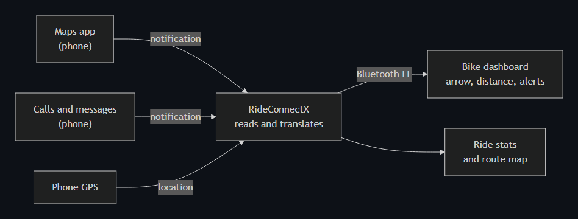
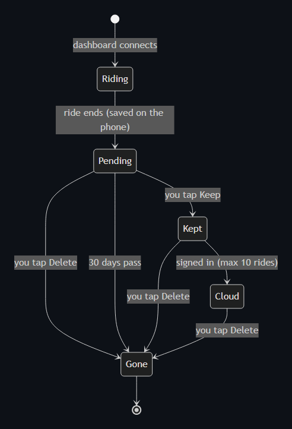
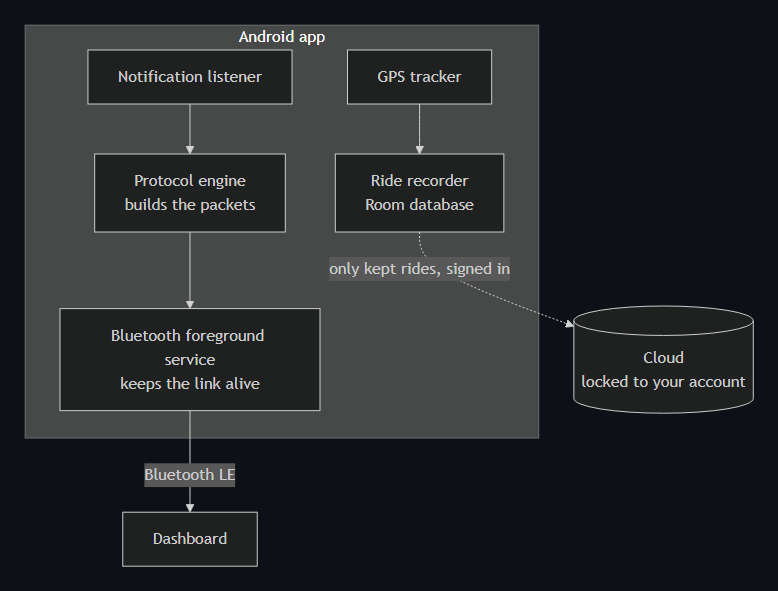
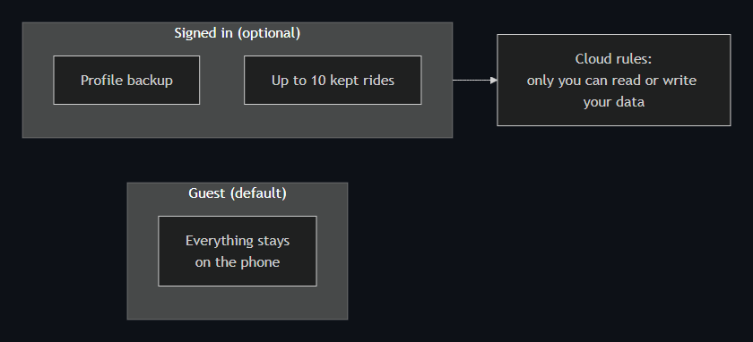

<div align="center">


### Turn-by-turn directions, call alerts and live ride stats on your bike's own dashboard.


[Idea](#the-idea) · [Features](#features) · [Live rides](#live-gps-rides) · [How it works](#how-it-works) · [Privacy](#privacy-and-security) · [Build](#build-it) · [Roadmap](#roadmap)

</div>

> [!IMPORTANT]
> **RideConnectX is an independent, unofficial, community project.** It is not made, approved, sponsored or supported by any vehicle manufacturer or by Google. All product names belong to their owners. It is **not a safety device**: obey road law and never look at your phone while riding. Use at your own risk.

---

## The idea

Some bikes and scooters have a small Bluetooth dashboard that can show a turn arrow. **RideConnectX** feeds that dashboard with what a rider actually needs, so the phone can stay in the pocket:

<p align="center"></p>

It is built by one rider-developer, tested on a real 125 cc scooter, and works fully **offline as a guest**. No account needed.

## Features

| | What you get |
|---|---|
| 🧭 **Navigation** | The next turn, distance and ETA from your maps app, drawn on the dashboard. Left, right, straight, U-turn, slight turns, roundabout exits, forks, arrival. |
| 📞 **Calls** | The caller's name on the dashboard. The alert blinks once a second while the phone rings and stops when you answer or reject. |
| 💬 **Messages** | The sender's name for SMS and chat apps. Missed-call and unread counts, reset when you clear the notification. Message text never leaves the phone. |
| 📍 **Live rides** | Real-time GPS distance, speed, average and max. Your route is drawn on a map. See below. |
| 🔧 **Service** | Reminders based on the kilometres you really rode. Fuel log and mileage. |
| 🆘 **Safety** | Emergency contacts and one-tap location sharing. |
| 🔔 **Notifications** | One in-app page, grouped by day, swipe to delete. |
| 🎨 **Looks** | Light, dark or system. Accent colours, colour mixes, glass surfaces, adjustable text size, full screen-reader labels. |
| 🔁 **Reconnect** | Finds the dashboard again by itself when you come back in range. |

## Live GPS rides

Distance and speed come from the **phone's GPS, in real time**, so even a few metres of movement counts. The dashboard itself does not send speed or position.

<p align="center"></p>

- **Stands still, adds nothing.** GPS jitter and bad fixes are filtered out, so parking does not add fake distance.
- **Route map** of where you started, where you went and where you stopped.
- **You decide.** Every new ride waits 30 days for a Keep or Delete. If you decide nothing, it is removed on its own.
- **Cloud only on Keep**, only when signed in, and only 10 rides at a time. Guests never upload anything.

## How it works

<p align="center"></p>

1. A **notification listener** reads the live turn, distance and ETA, plus call and message notifications.
2. A **protocol engine** turns each event into the compact packet the dashboard expects and picks the right format for the connected model.
3. A **foreground service** keeps the Bluetooth link alive with the screen off and reconnects on its own.

A built-in **simulator** lets the whole app run on an emulator with no bike, which is how most of it is developed and tested.

## Works with many dashboards

One app, one list of paired dashboards. The app reads the model from the dashboard's own name and picks the right packet format by itself. You choose nothing.

| Family | Status |
|---|---|
| 125 cc scooter, LCD | ✅ Verified on a real bike |
| Other scooters, LCD | 🟡 Built from the protocol, not yet tested on a bike |
| Motorcycles | 🟡 Built from the protocol, first real test in progress |
| Colour-screen and electric | 🟡 Built from the protocol, not yet tested on a bike |

If you try it on another bike, please open an issue and tell us what happened.

## Privacy and security

<p align="center"></p>

- **No account needed.** Pairing, navigation, alerts and ride stats all work as a guest.
- **Message text is never sent or stored.** Only the sender's name is shown.
- **Cloud is opt-in** and locked so only your own account can read it. Rules check the shape and size of every write.
- **Locked-down release:** code scrambled, logs stripped, no debug tools, no secret keys in the code.
- **Your location** is used only while the dashboard is connected. Route points are never written to logs.

## Install

> **Beta, by invitation.** A public release is planned. For now the app is shared with friends and testers only. Open an issue if you would like to try it.

Android 9 or newer. When you have the APK: allow installs from that source, install, open the app, tap **Continue as guest**, grant Bluetooth, Location and Notification access, then pair your dashboard.

## Tech stack

**Kotlin · Jetpack Compose · Hilt · Room · DataStore · Firebase Auth and Firestore · WorkManager · Bluetooth LE · Fused Location**

Single-activity MVVM with clean domain, data and presentation layers. 286 unit tests.

```
app/            Android app
  src/main/       domain / data / presentation
  src/test/       unit tests
docs/           building, privacy policy, motion plan
tools/          virtual-cluster, decode a ride log into a dashboard view
site/           the privacy-policy web page
brand/          logo and wordmark
```

## Build it

```bash
git clone https://github.com/gnyaneshwar76/Ride_Connect_X.git
cd Ride_Connect_X
./gradlew assembleDebug
```

The debug build runs against the built-in simulator, so it works on an emulator with no hardware. Firebase setup and the signed release build are in **[docs/BUILDING.md](docs/BUILDING.md)**. You need your own `google-services.json`, which is not included.

## Roadmap

- [x] Turn-by-turn on the dashboard
- [x] Call and message alerts with names and counts
- [x] Live GPS rides with route map, Keep / Delete, 30-day auto-delete
- [x] Many dashboard families in one app
- [x] Themes, colour mixes and glass UI
- [ ] Verify more models on real bikes
- [ ] In-app bug reporting
- [ ] Release signing key and public release

## Contributing

Issues and pull requests are welcome. This is a learning project by one rider-developer. Please keep its independent, non-commercial spirit.

## License

[MIT](LICENSE) © the RideConnectX authors. Third-party components: [THIRD-PARTY-NOTICES.md](THIRD-PARTY-NOTICES.md).

<div align="center">

Built by a rider who was tired of a phone clamped to the handlebar.

</div>
